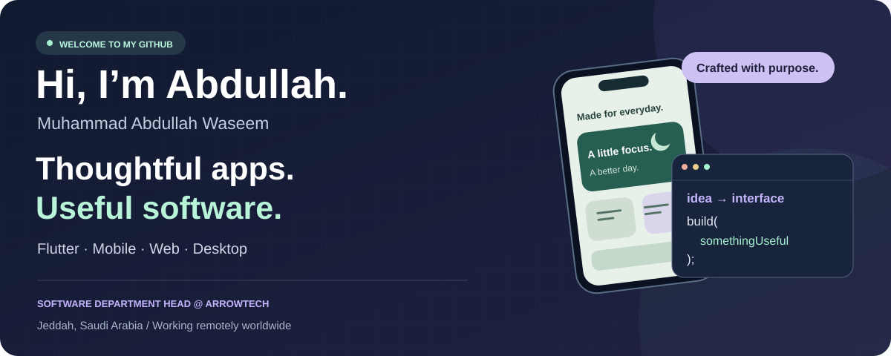
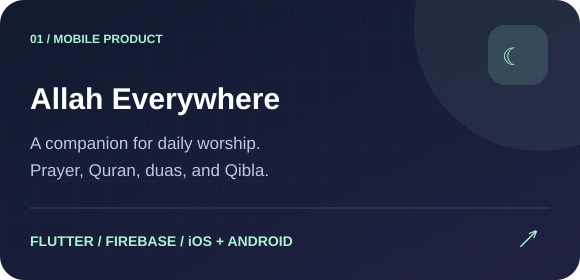
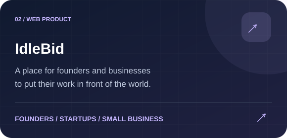
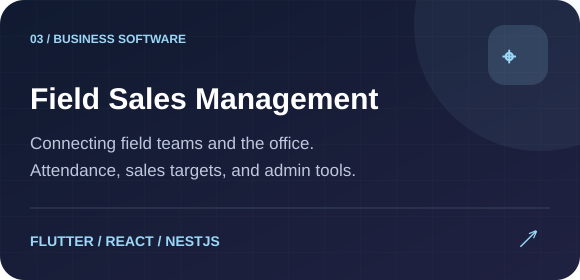
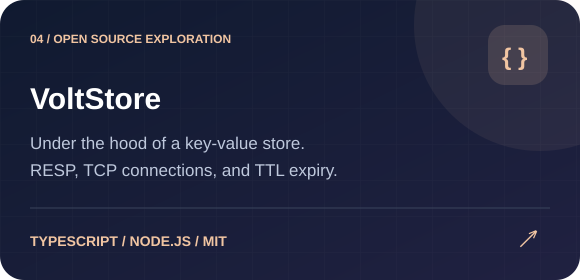
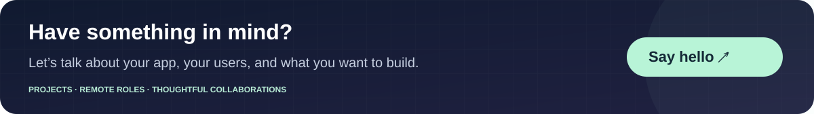

  

  
  
  

 

### A little about me

Thanks for stopping by. I'm **Muhammad Abdullah Waseem**, a Flutter developer and Software Department Head at [ArrowTech](https://arrowtech.sa/) in Jeddah, Saudi Arabia.

I enjoy turning an idea into something people can actually use: a calmer daily routine, an easier workflow, or an app that makes a complicated task feel simple. My work spans **mobile apps, web products, and desktop tools**, with a particular interest in thoughtful interfaces and Arabic/English experiences.

 

## Things I'm building

  
  

  
  

  <b>Try Allah Everywhere</b>  
  
  

**Also on my workbench:** [ATC Wristband Designer](https://github.com/abdullahwaseem-dev/atc-wristband-designer) — Flutter desktop tools for layouts, barcodes, and printing workflows.

Some repositories showcase commercial work and have restrictive licenses. VoltStore is MIT licensed; its browser dashboard is a simulation. Check each project's README and license before reusing code.

 

## My everyday toolkit

  

| Building for people | Connecting the pieces |
| :--- | :--- |
| Flutter apps for mobile and desktop | Firebase and backend APIs |
| Arabic/English layouts and RTL interfaces | Notifications and data workflows |
| Admin portals and business tools | Printing and device integrations |

 

## Let's build something useful

I'm open to **remote projects and software roles** involving Flutter, mobile apps, and business tools. Tell me what you're working on, who it's for, and where you need help.

  <a href="https://abdullah-waseem.vercel.app/">Portfolio</a> &nbsp; · &nbsp;
  <a href="https://www.linkedin.com/in/abdullahwaseem-dev/">LinkedIn</a> &nbsp; · &nbsp;
  <a href="mailto:maw112266@gmail.com">Email</a> &nbsp; · &nbsp;
  <a href="https://github.com/abdullahwaseem-dev?tab=repositories">Explore my repositories</a>

  Found something useful? A star, a thoughtful issue, or a kind hello is always appreciated.

